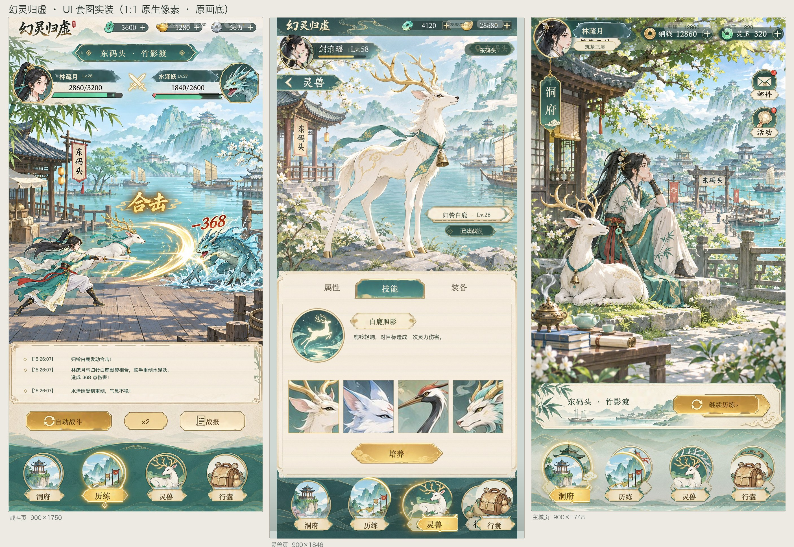

# 实装测试报告 · 幻灵归虚 UI 套件 v9.1

> 目的：不再比"像不像"，而是把素材真的装进界面跑一遍，看**能不能用**。
> 测试台：`09_实装测试/index.html`（浏览器直接打开，无需构建）

---

## 一、测试台做了什么

- 按概念图的**原始坐标**（900×1750 / 900×1846 / 900×1748）把素材摆回原位，1:1 原生像素，不缩放。
- 所有可拉伸件用**九宫格**渲染（逐块缩放，等价于引擎的 9-slice），切点取自 `九宫格切边.json`。
- 文字全部另起一层，验证"图里没有烧字"。
- 三种底：纯色（只看素材）、原画（模拟真实对局）、棋盘（看 alpha 边缘）。
- 滑杆：整体缩放、组件横向拉伸（−15%~+35%）、血量。
- 开关：九宫格切边线、安全区、已知问题标注。



---

## 二、装进去之后暴露的问题（已修）

第一次装配有 10 处问题，其中 9 处是素材本身的，逐个修掉：

| # | 现象 | 根因 | 处理 |
|---|---|---|---|
| 1 | 名条内部半透明、右侧一条**矩形硬边**和脏块 | 端头"镜像补全"是直接覆盖最终 RGBA，把透明留白也镜像过去了 | 重写：只取**没被压住的一侧**，再把干净端的笔锋**叠加**到缺的那端（带 alpha 合成），不延长画布 |
| 2 | 名条文字根本没擦掉 | 擦字框坐标写成相对值，又被减了一次 box 偏移，框跑到图外 | 改为绝对坐标 |
| 3 | 名条比原图**窄一圈**（42px vs 原图约 50px） | 掩膜内缩 1px + 羽化收紧 | 掩膜外扩 2px，把原图软边找回来 → 现在 48px |
| 4 | 导航图标/头像/技能圆**四角带方形底** | 这些是方块裁切，四角还留着导航条底色 | 按圆盘半径重做 alpha（r=0.44~0.46·边长），1px 抗锯齿 |
| 5 | 主面板**上边框混进绿色植物** | 裁切框从面板上沿往上多取了 9px 场景 | 按实测边界重出（B 页：y 897~1630） |
| 6 | 面板**四角露出青绿色三角** | 圆角外侧是场景，被一并抠进来了 | 按纸色判前景清角 + 最外 9px 几何圆角 |
| 7 | 面板边框与纸面之间有**白缝** | 纸面填充是内缩摆放，比边框内沿小 | 改成"纸面垫在边框环**下面**、同尺寸"，环内部透明处直接透出纸面（引擎里就是 fill 层 + frame 层） |
| 8 | 信息条金色按钮上「继续历练」还烧着 | 擦字框只盖了左侧标题 | 补擦按钮区域，开金饰保护（金底不被当字） |
| 9 | 竖挂牌带进**木帘/背景**，文字也擦不净 | 原框取大了；竖排窄牌用"行中值"会取到字色 | 按实测重抠（C 页 x40~99 / y196~418）；擦字改为**白色掩膜 + inpaint**，竖排不用行中值 |
| 10 | 主城左上双层角色牌怎么抠都带白块/树枝 | 牌被头像和花饰压住，右侧又是树枝，分离不出来 | **撤下该件**，主城统一用 `plate_name_enemy` 按 9 宫格拉成 210×58 |

> 另有一处**不是问题**：战报面板右侧的竹叶，是面板自带的画面装饰，不是脏边，保留。

---

## 三、九宫格行为验证

| 件 | 原生 | 切边 L/R/T/B | 拉宽 35% | 压窄 15% |
|---|---|---|---|---|
| `banner_scene` | 441×65 | 112/112/0/0 | 稳定 | 稳定 |
| `plate_name_enemy` | 236×48 | 24/24/0/0 | 稳定 | 稳定（笔锋不变形） |
| `btn_gold` | 305×70 | 101/40/0/0 | 稳定 | **出现接缝**：左端装饰占 1/3，压到 250 宽时中段被压 55px |
| `btn_train` | 333×76 | 92/92/0/0 | 稳定 | 稳定 |
| `btn_log` | 231×69 | 77/26/0/0 | 稳定 | 稳定 |
| `panel_main` | 837×733 | 40/40/40/40 | 稳定 | 稳定 |
| `panel_paper` | 880×200 | 32/32/32/32 | 稳定 | 稳定 |

结论：**除 `btn_gold` 外都可以自由拉伸**。`btn_gold` 请按原生 305 宽使用，或改成整体等比缩放（那会牺牲圆角一致性）。

---

## 四、启动模式（`index.html?play=1`）

把控制台收起来，按手机屏比例铺满窗口跑三页，等于真机预览：

- 开场封面（标题 + 点击进入）→ 进入游戏（默认落主城）
- **底部四个导航可以直接点**：洞府→主城、历练→战斗、灵兽→灵兽页、行囊→主城
- 背景默认用概念图原画当场景；`&bg=plain` 只看素材，`&bg=soft` 暗化虚化底
- 右下角「退出游戏 · 回测试台」回到带滑杆的测试台
- `&noboot=1` 跳过封面、`&s=battle|pet|city` 直接进某页

**这一轮真机铺满时抓到一个真 bug**：原画底原来用 `object-fit:cover` 铺 900 宽，852 宽的灵兽原画被横向拉伸 5.6%，页面越靠右错得越多（x=800 处偏 45px），名牌、头像、导航全部对不上。改成**按原画真实像素摆放**（`left=(w-aw)/2`，宽高用原尺寸）后，三页一次性对齐。这个问题在缩略图里看不出来，只有按 1:1 铺满才暴露。

同时修掉两处叠字：战斗页标题改由原画自己出（去掉重复的「幻灵归虚」）、血量数字在原画底时不再重复打；名条按实测左移到 x=160、拉宽到 236 盖住原画残留的笔画。

---

## 五、仍未解决的（坦白）

1. **源图只有 1x**（900×1750 的截图）。这套严格 1:1，进 2x/3x 设备会软——这是分辨率决定的，不是处理问题。
2. 名条的**笔锋有一端是镜像补的**（原图那一端被头像压住），左右不完全对称，1x 下看不出来，放大能看出。
3. 圆形件是圆形 alpha 硬裁，2x 下边缘会有 1px 轻微锯齿（可加 0.5px 羽化缓解）。
4. `panel_main` / `panel_paper` 只出**边框环**，内部要自己铺 `paper_fill` 或纯色；四角装饰是原图的阶梯角，横向拉伸过大时会轻微变形。
5. `07_写实件` 的宠物立绘原图只有 180px 高，进 2x 会明显发虚，需要原画资源替换。
6. 主城右侧只提供「邮件」一个功能钮（原图另一个是"活动"，图标不同，未单独提取）。

---

---

## 六、接进引擎时怎么用

```
底板类：直接贴，位置见 索引.md 的"用途"列
名条/页签/按钮：9-slice，切边见 九宫格切边.json，纵向不切片
面板：frame（边框环）+ fill（paper_fill 平铺）两层
圆形件：不要拉伸，等比缩放
```

字色参考（实装台用的值，可直接抄）：

- 墨绿底上的标题：`#e9e0c2`（横幅）、`#eae4cd`（名条）
- 金色按钮上的文字：`#4e3410`
- 纸面/米底上的文字：`#3c4a3c`、`#26433a`
- 页签选中态文字：`#f2ecd8`；未选中：`#5b5240`

---

_测试台内所有坐标、切边、字色都在 `index.html` 顶部的 `M` 清单与各 `screen*()` 函数里，改一处即可复现。_
